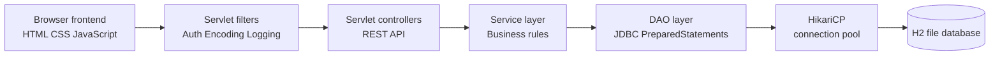

# RublinMart Project Demo Guide

## 1. Project Overview

RublinMart is a full-stack, multi-seller e-commerce marketplace. It allows buyers to browse products, manage a shopping cart, place orders, view order history, and submit verified product reviews. Sellers manage their own product listings and fulfillment status. Administrators supervise users, products, and platform orders.

The project demonstrates:

- Role-based authentication and authorization
- Product catalog search and category filtering
- Seller inventory management
- Buyer cart and checkout workflow
- Transactional order processing
- H2 database persistence through JDBC
- Password hashing with BCrypt
- REST-style Servlet APIs
- Responsive HTML, CSS, and Vanilla JavaScript frontend
- A configurable mock or Gemini chatbot
- Unit and database integration tests

## 2. Technology Stack

| Layer | Technology | Purpose |
| --- | --- | --- |
| Frontend | HTML5, CSS3, Vanilla JavaScript | Pages, forms, dashboards, AJAX calls |
| Web layer | Java Servlets | HTTP API endpoints |
| Business layer | Java services | Validation and application rules |
| Data layer | JDBC DAO classes | SQL queries and persistence |
| Database | H2 file database | Local relational data storage |
| Connection management | HikariCP | Connection pooling |
| JSON | Gson | Request parsing and response serialization |
| Security | jBCrypt and HttpSession | Password hashing and login sessions |
| Runtime | Apache Tomcat 9 | WAR deployment and Servlet execution |
| Build | Maven | Compilation, testing, and packaging |
| Testing | JUnit 5 and Mockito | Unit and integration-style tests |

The current Maven compiler configuration targets Java 17. The project documentation mentions Java 25, but Java 17 is the version configured in `pom.xml` and verified during the current build.

## 3. High-Level Architecture



### Request flow

1. A browser page sends a Fetch API request to `/rublinmart/api/v1/...`.
2. `AuthFilter` checks the current HTTP session and role for protected paths.
3. A Servlet controller reads the request and chooses the operation.
4. A service validates input and applies business rules.
5. A DAO executes parameterized SQL through HikariCP.
6. The Servlet returns a consistent Gson JSON response containing `success`, `data`, and `error`.
7. Frontend JavaScript updates the page without a full server-rendered view.

## 4. Main Java Packages

### Controllers

Located under `src/main/java/com/rublin/rublinmart/controller`.

- `AuthServlet`: registration, login, logout, and current-user lookup
- `ProductServlet`: product search, details, seller create/update, and deletion
- `CartServlet`: cart retrieval, add, update, remove, and clear
- `OrderServlet`: checkout and buyer order history
- `ReviewServlet`: public review retrieval and verified review creation
- `SellerServlet`: seller products, seller orders, and status updates
- `AdminServlet`: users, products, and all orders for administrators
- `ChatServlet`: chatbot requests
- `HealthServlet`: database health check

### Services

Located under `src/main/java/com/rublin/rublinmart/service`.

Services contain the rules that should not be placed directly in a Servlet. Examples include password validation, stock checks, seller ownership checks, order total calculation, review eligibility, and order-status validation.

### DAOs

Located under `src/main/java/com/rublin/rublinmart/dao`.

DAO classes isolate SQL from the rest of the application. They use `PreparedStatement` parameters instead of concatenating user input into SQL statements.

### Filters and listener

- `AuthFilter` protects admin, seller, cart, checkout, and order pages.
- `EncodingFilter` applies UTF-8 encoding.
- `LoggingFilter` records method, path, HTTP status, and duration.
- `DatabaseContextListener` initializes HikariCP, resets the development database, loads the schema, and loads seed data when Tomcat starts.

## 5. User Roles

### Buyer

A buyer can:

- Browse and search the marketplace
- Filter products by category
- View product details and reviews
- Add products to the cart
- Change quantities or remove items
- Place an order
- View order history
- Review products they have purchased

### Seller

A seller can:

- View only their own product listings
- Add products
- Edit their own products
- Delete their own products
- View orders containing their products
- Update fulfillment status to `PENDING`, `CONFIRMED`, `SHIPPED`, `DELIVERED`, or `CANCELLED`

### Administrator

An administrator can:

- View all platform users
- Filter users by role through the API
- View all products
- Delete products for moderation
- View all platform orders

Public registration accepts only `BUYER` and `SELLER`; public users cannot create an `ADMIN` account.

## 6. Frontend Pages

The pages are under `src/main/webapp/pages`.

| Page | Purpose |
| --- | --- |
| `index.html` | Landing page and featured product catalog |
| `products.html` | Full marketplace search and category filtering |
| `product-details.html` | Product information, ratings, reviews, and add-to-cart action |
| `register.html` | Buyer or seller registration |
| `login.html` | Login with demo account helper |
| `cart.html` | Cart items, quantities, subtotal, and checkout link |
| `checkout.html` | Order summary and mock payment confirmation |
| `order-success.html` | Confirmation page after order placement |
| `orders.html` | Buyer purchase history |
| `seller-dashboard.html` | Seller products and incoming orders |
| `admin-dashboard.html` | User, product, and order administration |
| `403.html`, `404.html`, `500.html` | Error pages |

The main browser JavaScript modules are:

- `auth.js`: session check, login, registration, logout, and dynamic navigation
- `products.js`: product list, category filter, details, and reviews
- `cart.js`: cart operations and cart badge
- `checkout.js`: order summary, mock payment, success page, and buyer orders
- `seller.js`: seller dashboard operations
- `admin.js`: administrator dashboard operations
- `chatbot.js`: floating assistant widget

## 7. Database Design

The schema is defined in `src/main/resources/db/schema.sql`.

### Tables

- `users`: account identity, email, BCrypt password hash, role, and creation time
- `products`: seller-owned catalog items, price, stock, category, and image URL
- `cart_items`: current buyer cart contents with a unique user/product pair
- `orders`: buyer order header, status, total amount, and creation time
- `order_items`: products and quantities captured in each order
- `reviews`: product rating, comment, reviewer, and timestamp

Foreign keys preserve relationships. Indexes support email lookup, seller lookup, category filtering, buyer orders, cart lookup, and product reviews.

### Database startup behavior

The database URL is:

```text
jdbc:h2:file:./data/rublinmartdb;DB_CLOSE_DELAY=-1;AUTO_SERVER=TRUE
```

This is an embedded file-based H2 database. It is not a separate database server that must be started manually. When the web application starts, `DatabaseContextListener`:

1. Initializes HikariCP.
2. Creates the schema and applies `db/seed.sql` when the database is new.
3. Applies the repeat-safe `db/catalog.sql` additions on every startup.

The initial demo seed is not reapplied to an existing database, so changes made during a demo are preserved. The daily essentials account and products are inserted only when missing.

## 8. Seed Accounts

All seed accounts use the password `Password@123`.

| Role | Email |
| --- | --- |
| Admin | `admin@rublinmart.com` |
| Seller | `seller1@rublinmart.com` |
| Seller | `seller2@rublinmart.com` |
| Seller | `dailyneeds@rublinmart.com` |
| Buyer | `buyer1@rublinmart.com` |
| Buyer | `buyer2@rublinmart.com` |
| Buyer | `buyer3@rublinmart.com` |

For the cleanest presentation, use the seeded accounts instead of temporary accounts created during testing.

## 9. Recommended Live Demo Script

### Part A: Public marketplace

1. Open `http://localhost:8080/rublinmart/pages/index.html`.
2. Show the marketplace hero section and featured products.
3. Open **Browse Products**.
4. Search for `laptop` or `headphones`.
5. Filter by `Electronics` or `Fashion`.
6. Open a product and explain price, stock, seller, rating, and reviews.
7. Open the chatbot and send a short question.

### Part B: Buyer journey

1. Log in as `buyer1@rublinmart.com` with `Password@123`.
2. Add a product to the cart.
3. Open the cart and increase or decrease quantity.
4. Explain that the server checks live stock before accepting the quantity.
5. Open checkout.
6. Explain that payment is mocked for the demonstration.
7. Confirm the order.
8. Show the order-success page and buyer order history.
9. Open a purchased product and submit a review.
10. Explain that only a buyer with a matching purchase can submit a review.

### Part C: Seller journey

1. Log out and log in as `seller1@rublinmart.com` with `Password@123`.
2. Open the Seller Studio.
3. Show the seller's products and incoming orders.
4. Add a product with a name, description, price, category, stock, and image URL.
5. Edit the product.
6. Update an order from `CONFIRMED` to `SHIPPED` or `DELIVERED`.
7. Explain that seller product updates are restricted to the logged-in seller's own products.

### Part D: Administrator journey

1. Log out and log in as `admin@rublinmart.com` with `Password@123`.
2. Open the Admin Panel.
3. Show the user directory, product moderation table, and system order log.
4. Explain that admin authorization is checked before the protected API is executed.
5. Demonstrate product moderation only if it is acceptable to delete demo data.

### Part E: Health check

Open:

```text
http://localhost:8080/rublinmart/api/v1/health
```

Expected response:

```json
{"success":true,"data":{"db":"UP","status":"UP"},"error":null}
```

## 10. Important Business Logic to Explain

### Authentication

- Registration validates name, email, role, password, confirmation password, and password length.
- Passwords are stored as BCrypt hashes, not plain text.
- Login creates an HTTP session containing the authenticated user.
- The session timeout is configured for 30 minutes.
- Invalid credentials return an unauthorized response without exposing whether the email exists.

### Authorization

`AuthFilter` checks roles before allowing access to admin and seller routes. Buyer-only pages require a session. Services also verify ownership where necessary, so a seller cannot edit another seller's product.

### Cart and stock

The cart is stored in the database. The service checks that requested quantities are positive and do not exceed available stock. The database enforces one cart row per user/product pair.

### Checkout transaction

The order process is intentionally transactional:

1. Read the buyer cart.
2. Confirm that products still exist and have enough stock.
3. Recalculate the total from current database prices.
4. Insert the order.
5. Insert order items.
6. Reduce stock using a stock-safe update.
7. Clear the cart.
8. Commit all changes together.

If a step fails, the transaction rolls back.

### Reviews

A review must have a rating from 1 to 5 and a non-empty comment. The service checks that the buyer purchased the product and has not already reviewed it.

### Chatbot

The default provider is `mock`. The application can use `GeminiChatProvider` when configured with a provider value of `gemini` and a valid API key. Messages are limited to 500 characters and rate-limited to one request per two seconds per IP address.

## 11. API Summary

All APIs use the base path `/rublinmart/api/v1`.

| Method | Endpoint | Access | Purpose |
| --- | --- | --- | --- |
| `POST` | `/auth/register` | Public | Create buyer or seller |
| `POST` | `/auth/login` | Public | Start session |
| `POST` | `/auth/logout` | Authenticated | End session |
| `GET` | `/auth/me` | Session | Return current user |
| `GET` | `/products` | Public | Search products |
| `GET` | `/products/categories` | Public | List categories |
| `GET` | `/products/{id}` | Public | Product details |
| `POST` | `/products` | Seller | Add product |
| `PUT` | `/products/{id}` | Seller | Edit owned product |
| `DELETE` | `/products/{id}` | Seller/Admin | Delete product |
| `GET` | `/cart` | Authenticated | Read cart |
| `POST` | `/cart/add` | Buyer | Add item |
| `POST` | `/cart/update` | Buyer | Change quantity |
| `POST` | `/cart/remove` | Buyer | Remove item |
| `DELETE` | `/cart` | Buyer | Clear cart |
| `POST` | `/orders` | Buyer | Place order |
| `GET` | `/orders` | Buyer | Buyer order history |
| `GET` | `/orders/{id}` | Buyer/Seller | Order details with access checks |
| `GET` | `/reviews?productId={id}` | Public | Read product reviews |
| `POST` | `/reviews` | Authenticated buyer | Add verified review |
| `GET` | `/seller/products` | Seller | Seller listings |
| `GET` | `/seller/orders` | Seller | Seller orders |
| `POST` | `/seller/orders/{id}/status` | Seller | Change fulfillment status |
| `GET` | `/admin/users` | Admin | View users |
| `GET` | `/admin/products` | Admin | View all products |
| `GET` | `/admin/orders` | Admin | View all orders |
| `POST` | `/chat` | Public | Chatbot response |
| `GET` | `/health` | Public | Database health |

## 12. Build and Run

From the project root:

```powershell
mvn clean test
mvn clean package
mvn tomcat7:run
```

Open the application at:

```text
http://localhost:8080/rublinmart/pages/index.html
```

The packaged artifact is:

```text
target/rublinmart.war
```

If Maven is not available on `PATH`, use the Maven installation configured in VS Code or install Maven and set `MAVEN_HOME` and `PATH`.

## 13. Tests

The project contains tests for:

- Password hashing and password verification
- Authentication registration and login rules
- User DAO create and find operations
- Product DAO create and search operations
- Cart stock validation and subtotal calculation
- Order placement and empty-cart handling
- Database schema and seed initialization

Run them with:

```powershell
mvn test
```

## 14. Security and Reliability Points

- SQL statements use prepared parameters.
- Passwords are BCrypt-hashed.
- Session-based access control protects role-specific routes.
- Product ownership is checked before seller updates and deletion.
- Server-side prices are used during checkout.
- Stock reduction is guarded by an available-stock condition.
- Database changes for checkout are committed atomically.
- API errors return controlled messages rather than stack traces.
- UTF-8 request and response encoding is applied globally.

## 15. Scope and Demo Limitations

These points should be stated clearly during a presentation:

- Checkout uses a mock payment step; no real payment provider is integrated.
- The default chatbot provider is a mock provider unless Gemini configuration is supplied.
- Database startup resets the local development database and seed data.
- The application is designed as a local Tomcat demonstration, not a production deployment configuration.
- The Maven build currently targets Java 17, despite the README describing Java 25.
- External product images and Font Awesome assets depend on network access in the browser.

## 16. Short Presentation Script

> RublinMart is a Java Servlet-based multi-seller e-commerce platform. The frontend is built with HTML, CSS, and Vanilla JavaScript, while the backend exposes REST-style Servlet endpoints. The application separates controllers, services, and JDBC DAOs, and uses H2 with HikariCP for persistence.
>
> The system has three roles: buyers, sellers, and administrators. Buyers browse products and complete a database-backed checkout. Sellers manage their own inventory and update order fulfillment. Administrators monitor users, products, and orders.
>
> A key design feature is transactional checkout. The server recalculates the order total, verifies stock, creates the order, inserts order items, reduces inventory, and clears the cart in one transaction. If any step fails, the transaction rolls back.
>
> Security is handled with BCrypt password hashing, HTTP sessions, role checks in `AuthFilter`, ownership checks in services, and prepared SQL statements. The project also includes a chatbot, health endpoint, seed data, and automated tests for the main business rules.
